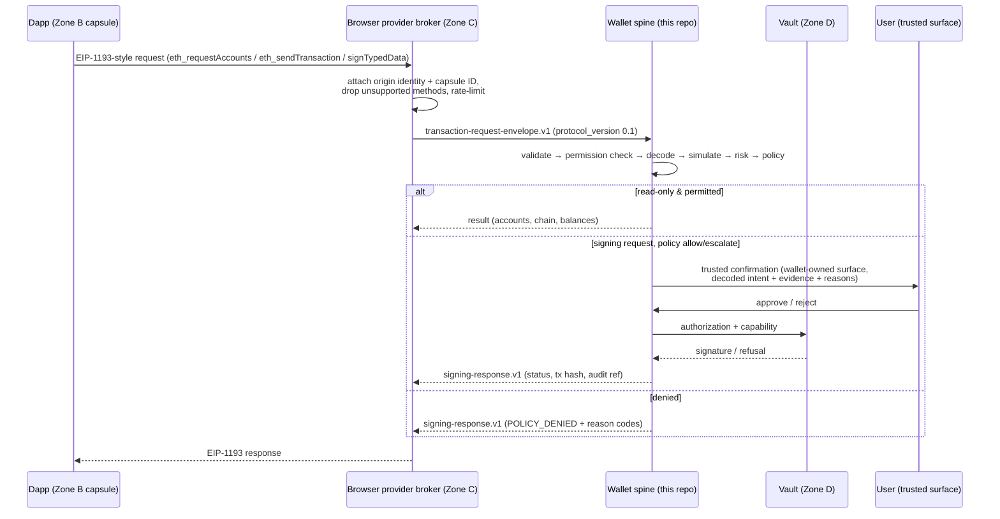

# Browser–Wallet Protocol (Browser-Connect Interface)

**Version:** 0.4 (typed_data/personal_message signing + read-only RPC proxy, ADR-019; additive over v0.3's host-attested transport, ADR-013; published by the wallet repo; the browser repo consumes a pinned copy (imports/wallet/)) · **Status:** live transport implemented (`connect serve`), protocol v0.4

## Purpose

The versioned interface through which any browser (the CipherLayer Browser after its gate, or a third-party integration) talks to the wallet trust spine. The browser is **untrusted**: it forwards dapp requests and renders results; it never holds keys, never evaluates policy, never renders the final confirmation surface.

## Design rules

1. Every message is a schema-validated envelope (`transaction-request-envelope.v1.json`); unknown methods are rejected, not ignored.
2. **Mandatory origin identity**: dapp origin + capsule ID attached by the browser broker, verified non-empty by the wallet. Identity-less requests are rejected (regression-tested today).
3. Read-only and signing scopes are distinct permission grants with independent expiry.
4. Signing requests always traverse the full pipeline (decode → simulate → risk → policy → USER_REVIEW on the **wallet's** trusted surface — never inside browser-rendered content).
5. Responses carry decision provenance (policy reason codes, risk evidence, simulation provenance) so the browser can display *why*, without being able to alter *what*.
6. Versioning: `protocol_version` field; additive changes bump minor; breaking changes require a new major and a migration note in both repos.

## Browser-to-wallet flow

## Message set (v0.4)

| Message | Direction | Schema | Notes |
|---|---|---|---|
| `host_attest` | browser → wallet | — | **v0.3:** the browser host presents the launch token; the wallet marks the *connection* attested. Required before any capsule-bearing message (below). |
| `connect_request` | browser → wallet | dapp-permission.v1 | origin, requested chain(s), scope (read-only/signing), requested expiry |
| `connect_response` | wallet → browser | dapp-permission.v1 | granted scope + expiry; never more than requested |
| `transaction_request` | browser → wallet | transaction-request-envelope.v1 | `payload.kind` = `evm_transaction` (default) \| `typed_data` \| `personal_message` (**v0.4**, additive — see below) |
| `signing_response` | wallet → browser | signing-response.v1 | terminal state, tx hash **or** `signature_hex` (v0.4), refusal reasons, audit reference |
| `permission_revoke` | either | dapp-permission.v1 | user- or wallet-initiated |
| `capability_query` | browser → wallet | wallet-capability.v1 | what the wallet supports (chains, methods, protocol version) |
| `rpc_query` | browser → wallet | rpc-query.v1 | **v0.4:** read-only JSON-RPC proxy, whitelist-only — see below |

`signing_response` v1.2 (additive): an optional `review_evidence` object carries display-only pipeline evidence (decoded intent, simulation outcome, risk level + detector findings including Scam Guard reason codes, policy verdict/reasons) so the browser can render why. It has no authority; the wallet never consumes it, and the confirmation decision stays on the wallet-owned surface.

### Typed-data and message signing (protocol v0.4)

`transaction_request`'s `payload.kind` is now additive over the v0.3 shape: absent (or `"evm_transaction"`) is unchanged behavior; `"typed_data"` carries the full `eth_signTypedData_v4` JSON payload in `payload.typed_data_json`; `"personal_message"` carries the `personal_sign` message as `payload.message_hex` (`0x`-hex, since the raw bytes need not be valid UTF-8). Both traverse the **same** validate → decode → risk → policy → USER_REVIEW → vault pipeline as a transaction (design rule 4) — this is not a bypass:

- **Decode.** `typed_data` is parsed and classified by `cipherlayer-evm::typed_data` (CL-EVM-003/004): EIP-2612/DAI-style permits project into the same `Permit` action the calldata decoder produces for on-chain `approve`/`permit`, so they hit the identical unlimited-approval policy rule (`POL-APR-001`, default-deny). Anything that doesn't match a recognized permit shape classifies `unknown` at `Confidence::Unknown`, which takes policy's restrictive unknown-action path (`POL-UNK-001`, escalate-or-deny by policy) — never a quiet "Sign" prompt (closes AC-C end-to-end). `personal_message` decodes deterministically: valid UTF-8 is shown as readable text, otherwise as hex — never mangled, never silently dropped.
- **Chain identity.** The EIP-712 domain's `chainId`, when present, is compared against the session/envelope chain; a definite mismatch denies outright (`POL-CHAIN-002`) — the same cross-chain-replay discipline as AC-D. A domain that omits `chainId` (legal per EIP-712) is not treated as a match, but is not flagged either (honest "not verifiable", not a denial).
- **Simulation is N/A, not faked.** Neither kind produces an on-chain transaction, so nothing is simulated; this is recorded as `SimulationStatus::NotApplicable` in policy evidence — a distinct, honest state from `Unavailable` ("should have simulated and couldn't", which still restricts). `NotApplicable` does not, by itself, force the unknown-action escalation path.
- **Vault.** Signing is exposed via the existing `signing-request.v1` `payload.kind` values (already reserved: `evm_transaction` \| `typed_data` \| `personal_message`). The Vault re-parses/re-hashes the raw payload itself rather than trusting a pipeline-supplied digest — the same "never blind-sign a hash" discipline that keeps `eth_sign` forbidden. `typed_data` signs the EIP-712 digest (`eip712_signing_hash`); `personal_message` signs via the standard EIP-191 personal-message hash. The response carries the raw signature as `signature_hex` (`signing-response.v1` v1.3); there is no tx hash, no broadcast — `SIGNED` is these requests' legitimate terminal state.

### Read-only RPC proxy (protocol v0.4)

`rpc_query` forwards a **STRICT hardcoded whitelist** of pure chain-state reads to the wallet's own RPC endpoint for the session's granted chain: `eth_call`, `eth_estimateGas`, `eth_blockNumber`, `eth_getBalance`, `eth_gasPrice`, `eth_getTransactionByHash`, `eth_getTransactionReceipt`, `net_version`. None of these can move funds, change permissions, or produce a signature — see ADR-019 for why this makes the whitelist safe to proxy without traversing decode/policy/USER_REVIEW at all. Anything off the whitelist is refused with the transport's existing `malformed_or_unsupported` error, never forwarded; the list is not caller- or config-extensible. Requires an active permission grant (read-only class suffices) for the capsule on the requested chain, and, being capsule-bearing, requires host attestation like `connect_request`/`transaction_request`. Both the request `params` and the RPC `result` are size-bounded. **No per-query audit event** is emitted (ADR-019): these are high-volume, no-consequence reads, and logging every one would flood the hash-chained audit log with routine traffic that has no forensic value; connection-level enforcement (attestation, permission, whitelist, size caps) still applies on every call regardless.

### Host attestation (protocol v0.3)

`capsule_id` is a plaintext bearer string in each envelope's `caller`, and grants are keyed by `dapp:{origin}#{capsule_id}`. Without more, any local peer that reaches the socket could forge another capsule's id and ride its grant (threats T-18/T-19; measured by the browser capsule-isolation experiment). v0.3 closes this for non-host peers with **host attestation** (ADR-013):

- The `connect serve` process holds a launch token — `CIPHERLAYER_CONNECT_HOST_TOKEN` (env, preferred) or a generated `<socket-dir>/connect-host-token` (0600).
- The host sends `{"message":"host_attest","token":"…"}`; the wallet replies `{"message":"attest_response","attested":true|false,"protocol_version":"0.3"}` and marks the **connection** attested on success.
- `connect_request`, `transaction_request`, and `permission_revoke` are refused on an un-attested connection: `{"message":"error","code":"attestation_required"}`. `capability_query` and `host_attest` need no attestation.
- **Honest bound:** the token distinguishes the launched host from any other peer; a same-user attacker who can read the env/file is local malware (T-14, accepted for the prototype). Per-capsule OS isolation (the engine's job, ADR-B002) is the defence-in-depth complement.

### Transport (protocol v0.3)

JSON-lines over a **same-user Unix domain socket** (`cipherlayer-cli connect serve`, default `./data/browser-connect.sock`). One request object per line, one response object per line; requests are tagged `{"message": "<name>", ...}` and anything unrecognized gets `{"message":"error", "code":"malformed_or_unsupported"}` — deny-by-default on the transport itself. The whole line is size-capped before parsing (envelope cap, T-22).

**Peer authentication:** the socket lives in a 0700 directory and the socket file is 0600, and capsule-bearing messages additionally require successful `host_attest`. Browser-side clients must refuse group/world-accessible sockets. The honest residual is same-user malware that can read the launch token.

**Concurrency (v0.3):** connections are served concurrently, one task per accepted connection; correctness-critical state (permissions, audit, the single vault/nonce space) stays serialized wallet-side, and `capability_query` never waits on another capsule's in-flight signing request.

**USER_REVIEW over the transport:** signing requests block on a wallet-owned surface. The default CLI prompt is explicitly labeled spoofable; `--vault-confirm` routes review to `cipherlayer-vaultd` tier-v1 confirmation. `--yes` auto-approval is an explicit, logged flag for tests and harnesses only.

Native messaging remains a candidate second transport for extension-based integrations (not designed).

## What the browser may cache / must not cache

May cache: capability query results, granted permission metadata (for UI), `rpc_query` results per the caller's own freshness needs (they are ordinary chain-state reads, not secrets). Must not cache or replay: signing responses, authorizations, capabilities' secret material (none exists — capabilities are references validated wallet-side, not bearer secrets in v0.1).

## Open items for v0.5 (tracked in browser repo)

Session continuity across browser restarts; batch requests; per-request attestation binding; pre-decision evidence streaming (today `review_evidence` arrives with the terminal response, not before USER_REVIEW). **Deliberately deferred from v0.4** (ADR-019): `wallet_switchEthereumChain`/`wallet_addEthereumChain` — chain-switching is a per-site-permissions design question (which chains a site may request, and how a switch is reviewed), not a mechanical wire addition, and per-site-permissions.md's design is not yet reconciled with a shipped implementation; forwarding it now would be moving faster than the design work. `wallet_watchAsset`, `wallet_getPermissions`/`wallet_requestPermissions` (EIP-2255) — low real-world incidence, cosmetic or rarely-used, not prioritized for this rev.
