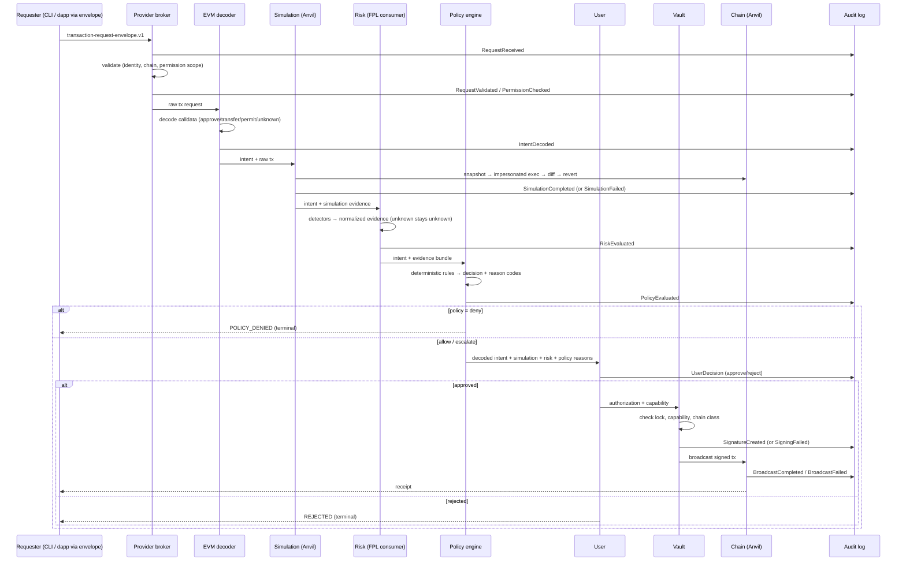
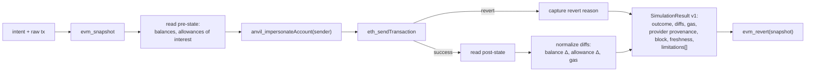
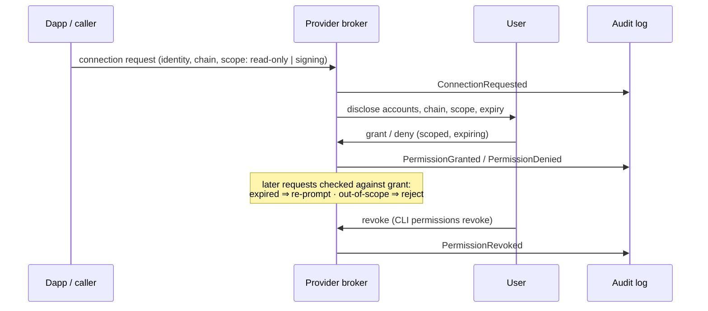
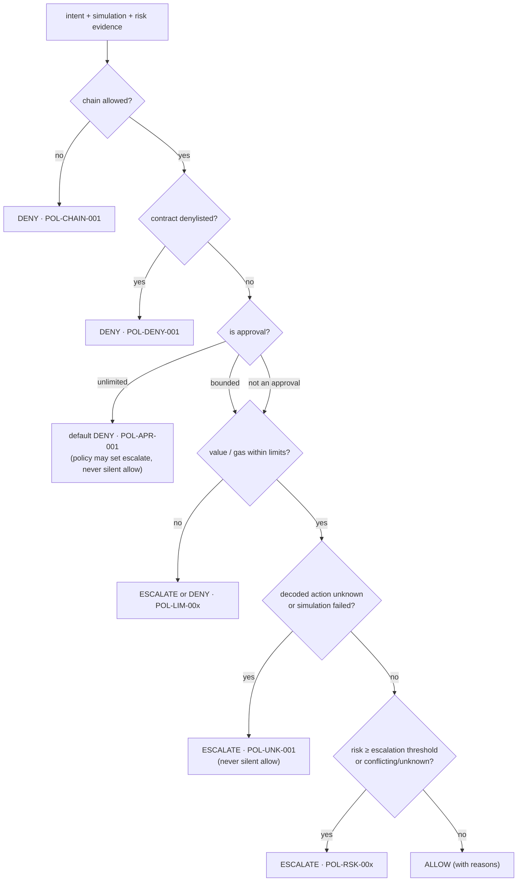

# Data Flow — CipherLayer Wallet

**Version:** 0.1 · Flows shown are implemented in the milestone-1 vertical slice unless marked deferred.

## Transaction-signing flow (end to end)

## Simulation flow (detail)

The result is **evidence with provenance, never a guarantee**; the `limitations` list is always non-empty (state drift, conditional contract behavior, single-provider view).

## Permission flow

## Policy-decision flow

Deny short-circuits are terminal; escalation requires explicit user confirmation at USER_REVIEW; **no path authorizes without the deterministic engine**.

## Audit trail

Every step above appends one hash-chained event (`audit-event.v1`): `RequestReceived → RequestValidated → PermissionChecked → IntentDecoded → SimulationCompleted|SimulationFailed → RiskEvaluated → PolicyEvaluated → UserDecision → SignatureCreated|SigningFailed → BroadcastCompleted|BroadcastFailed`, plus `ConnectionRequested/PermissionGranted/PermissionRevoked` and terminal failures. `audit inspect --request <id>` reconstructs a lifecycle; `audit verify` recomputes the hash chain.
