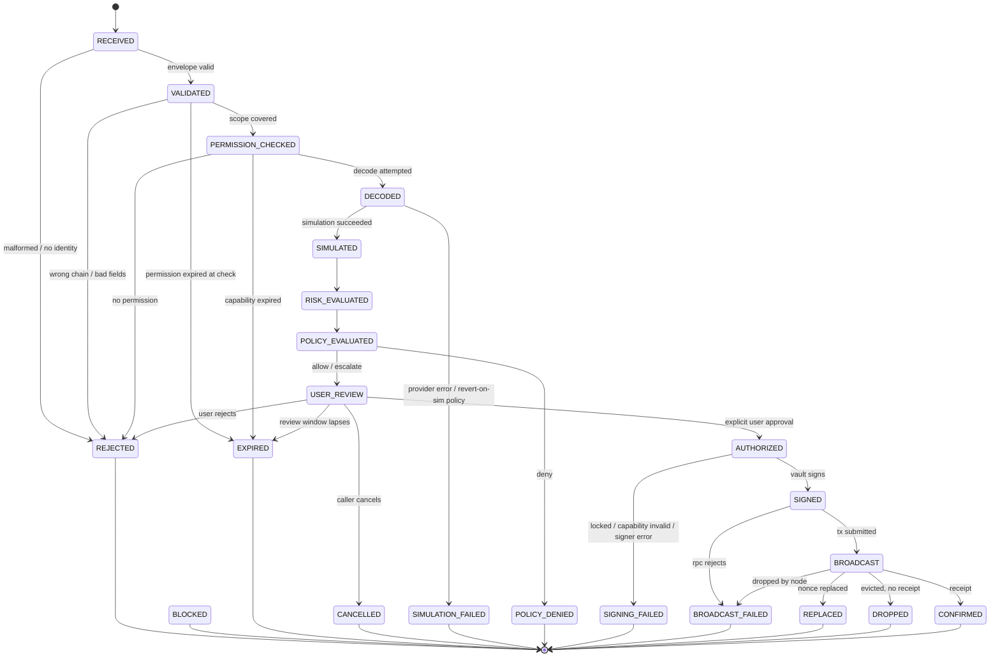

# Signing State Machine

**Version:** 0.1 · Implemented in `cipherlayer-types::state` (single source of truth); every transition validated and audited. **The system must not silently skip a required state** — the transition table is the only way to move, and illegal transitions are errors + audit events.

## States

Happy path (in order):

`RECEIVED → VALIDATED → PERMISSION_CHECKED → DECODED → SIMULATED → RISK_EVALUATED → POLICY_EVALUATED → USER_REVIEW → AUTHORIZED → SIGNED → BROADCAST → CONFIRMED`

Terminal / failure states:

`REJECTED · BLOCKED · EXPIRED · CANCELLED · SIMULATION_FAILED · POLICY_DENIED · SIGNING_FAILED · BROADCAST_FAILED · REPLACED · DROPPED · UNKNOWN`

## Diagram

Notes:

- `BLOCKED` is entered from any pre-signature state by an emergency lock or an explicit block rule; modeled as reachable from `RECEIVED..USER_REVIEW` (kept off the diagram for legibility, present in the transition table).
- `UNKNOWN` is the honest terminal for a lifecycle the system can no longer determine (e.g., audit reconstruction of an interrupted run). Nothing transitions *out* of `UNKNOWN`.
- `SIMULATION_FAILED` is terminal in milestone 1: the prototype refuses to proceed to signing without simulation evidence. A future policy may permit an explicit, escalated "proceed without simulation" path; that requires an ADR and a distinct transition, never a silent skip.

## Enforcement properties (tested)

1. **No skipping:** `Lifecycle::advance(next)` consults the transition table; e.g. `DECODED → POLICY_EVALUATED` (skipping simulation+risk) is rejected. Unit-tested exhaustively; property-based test asserts closure under the table.
2. **Terminal is terminal:** no transition leaves a terminal state.
3. **Audited:** every successful transition and every rejected attempt emits an audit event with request ID, from-state, to-state.
4. **Order encodes policy:** signing (`AUTHORIZED → SIGNED`) is unreachable without passing `POLICY_EVALUATED` and `USER_REVIEW` — the type system exposes no constructor for a mid-pipeline lifecycle.
