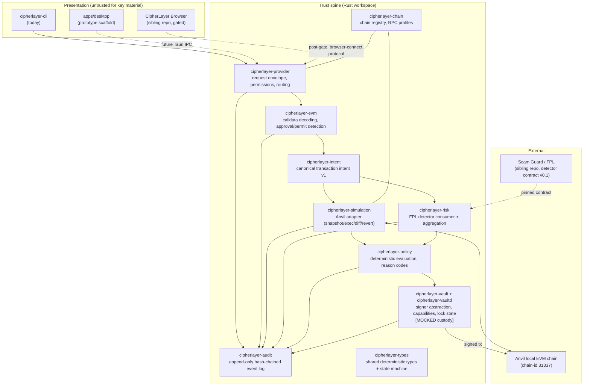
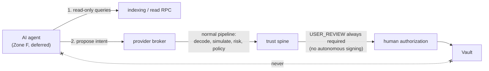

# System Overview — CipherLayer Wallet

**Version:** 0.2 · **Status:** prototype architecture, Rust trust spine + CLI + desktop UI scaffold

## What this system is

A wallet-first trust spine that makes transaction intent legible, simulation-supported, policy-controlled, auditable, and materially safer than blind signing. Presentation surfaces (CLI now; desktop prototype now; browser after the gate, in the sibling repo) consume the spine through versioned contracts; none of them ever hold keys or make security decisions.

## System architecture

`cipherlayer-types` underlies every crate (omitted from edges for legibility) and owns the signing state machine, so no crate can express an out-of-order pipeline.

## Module responsibilities

| Crate | Owns | Must never |
|---|---|---|
| `cipherlayer-types` | shared deterministic types, IDs, state machine | contain business logic or I/O |
| `cipherlayer-vault` | key refs, signer abstraction, test signer, capability validation, lock/unlock, authorization, vault IPC client types | depend on UI/browser; expose key material |
| `cipherlayer-policy` | policy schema, deterministic evaluation, reason codes, unlimited-approval rule | consult AI/heuristics; be bypassable by missing fields |
| `cipherlayer-chain` | chain registry, RPC profiles, network-class safety metadata | default signing to non-development chains (milestone 1) |
| `cipherlayer-evm` | calldata/typed-data decoding, approval & permit detection, EVM validation | guess: undecodable ⇒ `unknown` |
| `cipherlayer-intent` | canonical versioned transaction intent | lose provenance/unresolved fields |
| `cipherlayer-simulation` | provider-neutral simulation, Anvil impl, normalized results | hold signing authority; present results as guarantees |
| `cipherlayer-risk` | detector trait, normalization, aggregation, mock detector | rebuild FPL; let unknown become low; override policy |
| `cipherlayer-audit` | append-only hash-chained lifecycle events, verification | claim immutability; log key material |
| `cipherlayer-provider` | dapp/browser request envelope, permission scopes, routing, denial/timeout | accept identity-less requests |
| `cipherlayer-vaultd` | process-isolated Vault daemon, signing-request IPC, Vault-owned confirmation tier v1 | render web content; accept non-dev Vault keys; skip Vault validation |
| `cipherlayer-cli` | commands, demo driver, human-readable rendering | embed security logic (renders decisions, doesn't make them) |

## Agent authorization model (deferred capability surface)

No agent execution exists in milestone 1. The authorization *model* is fixed now (schema `agent-authorization.v1.json`) so later agent work cannot invent authority:

Authority ladder (BS §6.11): read-only → prepare-only → simulation-only → propose → bounded session-key execution (deferred, requires ADR) → never unrestricted key access. Every agent authorization names account, chain, contract, function, asset, amount, frequency, expiry, slippage, gas cap, revocation, notification.

## Status labels (BP §16)

| Component | Label |
|---|---|
| Pipeline (validate to broadcast), policy engine, decoder, intent, audit chain, provider envelope, chain registry, CLI | **prototype** |
| Anvil simulation adapter | **prototype** |
| Vault process isolation | **prototype** |
| Vault custody, secure storage | **mocked / deferred** |
| Trusted confirmation surface | **prototype tier v1** |
| External signer adapter | **partial prototype** |
| Hardware signer adapters | **theoretical** |
| Desktop app | **prototype scaffold** |
| Browser product shell, multi-provider simulation, institutional policy, agent runtime | **deferred / gated** |

## Related documents

[Trust boundaries](trust-boundaries.md) · [Data flow](data-flow.md) · [Signing state machine](signing-state-machine.md) · [Browser-wallet protocol](browser-wallet-protocol.md) · [Threat model](../threat-model/threat-model.md) · [Roadmap](../roadmap/implementation-roadmap.md)
