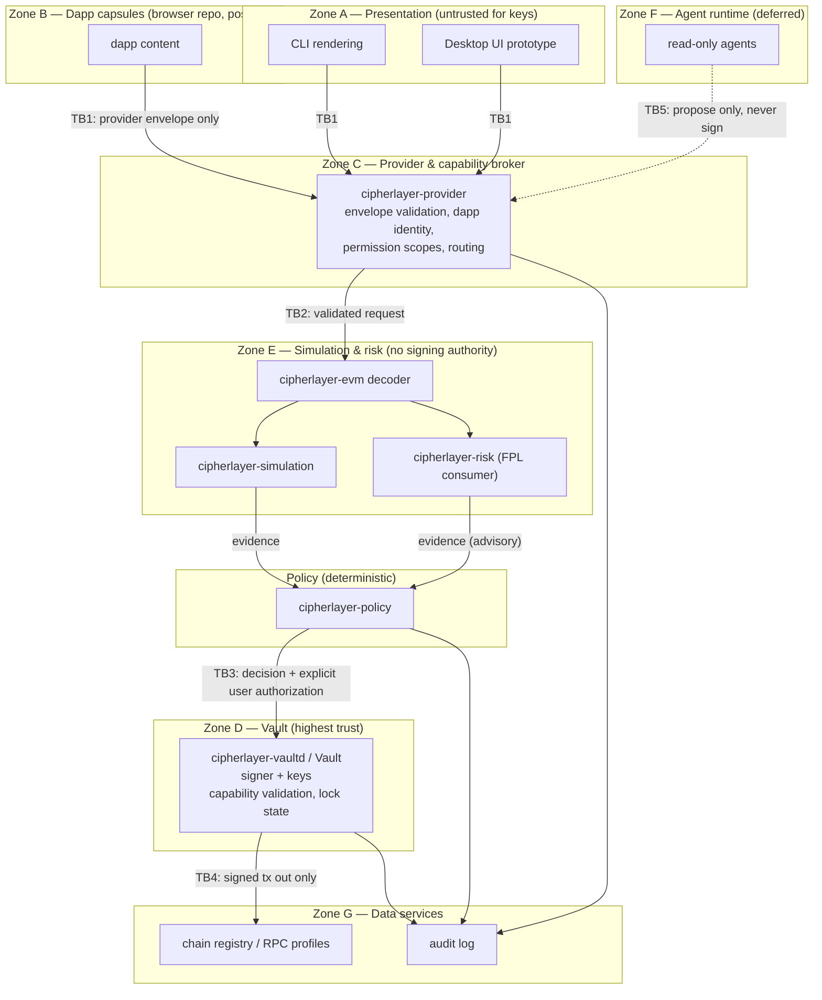

# Trust Boundaries — CipherLayer Wallet

**Version:** 0.1 · Zone letters follow BS §7.1; milestone-1 reality is annotated honestly.

## Trust-boundary diagram

## Boundary rules

| Boundary | Crossing | Rule | Milestone-1 enforcement |
|---|---|---|---|
| **TB1** presentation/dapp → broker | `transaction-request-envelope.v1` | Mandatory dapp/caller identity, chain scope, read-only vs signing declared. Identity-less requests rejected. | Envelope validation + regression test |
| **TB2** broker → analysis | validated request | Analysis zones get data, never authority; undecodable calldata ⇒ `unknown`, pipeline continues restrictively. | Types + tests |
| **TB3** policy → Vault | `signing-request.v1` + capability + user authorization | Vault signs only with: allow/escalate-satisfied policy decision, valid unexpired capability, explicit user confirmation, unlocked state, chain in `development` class. Risk/AI input can escalate, never authorize or downgrade. | Vault checks + regression tests |
| **TB4** Vault → chain | signed transaction | Only signed bytes exit; keys never serialize. Broadcast result audited. | Code review + type design |
| **TB5** agents → broker | proposal | Agents (deferred) may propose intents; USER_REVIEW is unskippable; no session keys in milestone 1. | State machine (no bypass path exists) |

Every crossing emits an audit event (see [data-flow](data-flow.md)).

## What is real vs mocked today

- **Real:** trait/type boundaries between all zones; deterministic policy gate in front of the signer; capability + lock checks; audit of every crossing; chain-class signing guard; optional `cipherlayer-vaultd` process boundary over signing-request.v1; protocol v0.3 host attestation for browser-connect.
- **MOCKED:** custody. The default Vault signer is still a well-known Anvil dev key with no secure storage or hardware backing (ADR-005).
- **Prototype:** trusted confirmation tier v1 exists in `cipherlayer-vaultd` on macOS (system dialog + secret phrase, fail closed). The CLI terminal prompt remains spoofable and is labeled as such.
- **Not built:** Zone B product browser shell (sibling repo, gated), Zone F agent runtime, SEP/biometric confirmation tier, hardware/native custody.

## Invariants (BP §4, enforced/tested where marked)

1. Keys never in renderer/presentation ✅ tested
2. Dapps never touch keys ✅ by construction (no API exists)
3. AI never sole control; cannot override deterministic denial ✅ tested
4. Every privileged action crosses an explicit capability boundary ✅ tested
5. Signing screens never theme/plugin/dapp-controlled — tier v1 tested for `cipherlayer-vaultd`; SEP/biometric tier still deferred
6. Unknown/conflicting evidence stays visible ✅ tested
